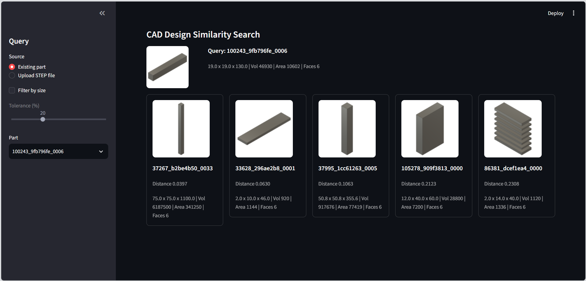

# CAD Design Similarity Search

Search a collection of 500 Fusion 360 CAD parts for geometrically similar
designs, using BRepNet embeddings and FAISS nearest-neighbor search.

## Run the app

```
conda activate brepnet
streamlit run app.py
```

(If the `brepnet` environment does not exist yet, see Environments below
for how to create it.)

This opens the app in a browser tab, usually at `http://localhost:8501`.
Once it is open:

1. In the sidebar, choose a query source: **Existing part** (pick a
   file stem from the dropdown) or **Upload STEP file** (upload a
   `.step`/`.stp` file not already in the 500-part set).
2. Optionally check **Filter by size** and adjust the **Tolerance**
   slider (5-50%, default 20%) to restrict matches to parts with
   similar bounding-box dimensions.
3. The query part and its top 5 matches appear in the main area, each
   with a thumbnail, distance, size, volume, area, and face count. If
   the size filter removes every candidate, the app shows "No matches
   within tolerance" instead of an empty result.



The example above queries `100243_9fb796fe_0006`, a thin column
(19 x 19 x 130). The top matches are other elongated bars at different
scales, which illustrates the size limitation noted below: embedding
distance tracks shape, not absolute size.

Stop the app with `Ctrl+C` in the terminal it is running in.

## How it works

Each STEP file is run through BRepNet, a graph neural network that
operates directly on B-Rep topology. BRepNet produces one embedding
vector per face of a part; these are mean-pooled into a single 84
dimensional vector per part. The 500 resulting vectors are indexed with
a FAISS `IndexFlatL2` index, so a query returns the parts with the
smallest L2 distance in embedding space.

A separate pipeline computes geometric properties for each part with
occwl: sorted bounding-box dimensions, volume, surface area, and face
count. These support an optional size filter that narrows embedding
matches down to parts of a similar physical size.

A new STEP file (not in the original 500) can be embedded with the same
BRepNet pipeline and searched against the existing index without
modifying it.

## Capabilities

- Query by an existing part's file stem, or upload a new STEP file.
- Top 5 nearest neighbors by embedding distance.
- Optional size filter: keep only matches whose sorted bounding-box
  dimensions are within a tolerance (5-50%, default 20%) of the query.
- Interactive Streamlit app with thumbnails and part properties.
- Notebook for inspecting a query and its top 3 matches.
- Command-line scripts for each step of the pipeline.

## Project status

- [x] BRepNet patched to run on a modern CPU-only Python stack
- [x] Embeddings generated for all 500 parts (`outputs/embeddings.npy`)
- [x] FAISS index built (`outputs/faiss_index.bin`)
- [x] Part properties computed for all 500 parts (`outputs/part_properties.csv`)
- [x] Existing-part query script
- [x] Size-filtered search
- [x] New-part search (embed and query without touching the index)
- [x] Streamlit app
- [x] Retrieval inspection notebook
- [ ] GPU acceleration (currently CPU-only)
- [ ] Automated test suite

## Project structure

```
app.py                          Streamlit app
src/
  build_faiss_index.py          Builds outputs/faiss_index.bin
  query_similar_designs.py      Query by stem, top 5 with distances
  part_properties.py            Geometric properties via occwl, builds outputs/part_properties.csv
  filtered_search.py            Search with an optional size filter
  search_new_part.py            Embed and search a new STEP file
  inspect_naming.py             Earlier exploration scripts
  inventory_data.py
  test_step_roundtrip.py
  verify_subset.py
notebooks/
  inspect_retrieval.ipynb       Query and view top 3 thumbnails
outputs/
  embeddings.npy                 500 x 84 BRepNet embeddings
  embeddings_manifest.json       File stem for each embedding row
  faiss_index.bin                FAISS IndexFlatL2 over the embeddings
  part_properties.csv            Size, volume, area, face count per part
data/processed/fusion360_subset/ 500 STEP files and their PNG thumbnails
external/
  BRepNet/                       Patched BRepNet (see Environments below)
  occwl/                         occwl, installed from source
docs/                             Project overview and reference slides
```

## Environments

Two separate environments are used. Neither has cadquery and faiss-cpu
installed together on purpose; cadquery was never installed into
`brepnet`.

- `.venv` (plain venv at the project root): the original cadquery-based
  project environment, now with `faiss-cpu` added.
- `brepnet` (conda environment): Python 3.10, `pythonocc-core`, `occwl`
  (installed from source), CPU-only PyTorch, `pytorch-lightning`,
  `faiss-cpu`, `streamlit`. All the scripts under `src/`, `app.py`, and
  the notebook run with this environment, since they need `occwl` and
  `torch`.

Create it with:

```
conda create -n brepnet python=3.10 pythonocc-core=7.7.0 -c conda-forge
conda activate brepnet
pip install torch --index-url https://download.pytorch.org/whl/cpu
pip install pytorch-lightning scikit-learn tqdm xlsxwriter trimesh matplotlib networkx pyDeprecate faiss-cpu streamlit
pip install -e external/occwl
```

### BRepNet patches

BRepNet's own `environment.yml` pins Python 3.7, PyTorch 1.7.1, and
pytorch-lightning 1.5.10, which no longer install cleanly. The code in
`external/BRepNet` was patched to run on current CPU-only PyTorch and
pytorch-lightning instead of trying to match those old pins:

- `models/brepnet.py`: `pytorch_lightning.core.lightning` import path
  changed to `pytorch_lightning` (the old path was removed).
- `models/brepnet.py`: `test_epoch_end` migrated to `on_test_epoch_end`
  (the old per-epoch hook was removed in pytorch-lightning 2.0); batch
  outputs are accumulated manually.
- `models/brepnet.py`: the `--input_features` and `--kernel` argparse
  defaults were relative paths that only worked when the caller's
  working directory happened to be the BRepNet root. They are now
  resolved from the module's own file location.
- `eval/evaluate_folder.py`: `Trainer.add_argparse_args` and
  `Trainer.from_argparse_args` were removed in pytorch-lightning 2.0;
  replaced with a plain `Trainer(accelerator="cpu", logger=False)`.
- `eval/evaluate_folder.py`: PyTorch 2.6 changed `torch.load`'s default
  to `weights_only=True`, which rejects the pytorch-lightning classes
  stored in BRepNet's official pretrained checkpoint. `torch.load` is
  monkeypatched back to `weights_only=False` for this trusted,
  first-party checkpoint.
- `eval/evaluate_folder.py`: the `--segment_names` default was a
  relative path; it is now resolved from the module's own file
  location so `evaluate_folder()` works regardless of the caller's
  working directory.
- `pipeline/extract_brepnet_data_from_step.py`: the per-file STEP
  extraction loop now catches and logs exceptions per file instead of
  aborting the whole batch on the first bad file.
- `run_batch_embeddings.py` (new file): batch-embeds all 500 STEP files
  and writes `outputs/embeddings.npy` and
  `outputs/embeddings_manifest.json`.
- `embed_step_file.py` (new file): embeds a single STEP file in a
  disposable temp folder, used by `search_new_part.py` and the app's
  upload flow.

## Usage

Activate the `brepnet` environment first:

```
conda activate brepnet
```

Build the index and part properties (already done; only needed again if
the source STEP files change):

```
python src/build_faiss_index.py
python src/part_properties.py
```

Query an existing part:

```
python src/query_similar_designs.py 100243_9fb796fe_0006
python src/filtered_search.py 100243_9fb796fe_0006 --tolerance 0.2
```

Search with a new STEP file not in the index:

```
python src/search_new_part.py path/to/new_part.step --filter --tolerance 0.2
```

Run the app:

```
streamlit run app.py
```

## Data source

The 500 parts come from the Fusion 360 Gallery segmentation dataset
(Autodesk). The dataset and BRepNet's pretrained model are both for
non-commercial use only (BRepNet is licensed CC BY-NC-SA 4.0).

## Known issues

- BRepNet is weaker on complex parts with many faces than on simple
  ones; it was trained on the relatively simple parts in the Fusion 360
  Gallery segmentation dataset.
- Embeddings barely encode absolute size. BRepNet scales every part
  into a unit box before extracting features, so two parts with very
  different real-world dimensions can have near-identical embeddings.
  The size filter in `filtered_search.py` can therefore produce a very
  different ranking from the unfiltered embedding search.
- A few parts sit at extreme scales (very thin or very large), which
  makes the relative size tolerance less meaningful for them than for
  typically-sized parts.
- A malformed STEP file can still crash BRepNet even after it loads
  successfully with occwl. `search_new_part.py` and the app validate
  that the file loads with occwl before embedding it, but BRepNet has
  its own stricter assumptions (manifold, closed, single-solid
  geometry) that occwl loading alone does not catch.
